# DESIGN.md — Diseño de Sistema: Seudonimización y Resolución de Entidades (Kipu Pay)

## 1. Problema, Puntaje y Modelo de Amenazas
Kipu Pay, una fintech colombiana, vende su corpus multimodal de soporte (**2.028 mensajes** en 320 hilos, **26 documentos** y **6.243 filas** en 4 tablas; **8.297 registros**, ~435k tokens) para entrenar modelos de atención al cliente. Entregamos el mismo corpus 1-a-1 en `output/` (`chats.jsonl`, `docs.jsonl`, `tables.jsonl`), sin que se pueda saber quién es quién, más un diccionario `entities.json` exclusivo para el jurado y el servicio HTTP bajo `/v1`.

| Dimensión | Puntos | Desglose | Qué nos obliga a hacer |
|---|---|---|---|
| **Fuga** | **45** | 35 por tests puntuales + 10 por barrido global | Ninguna forma real en ningún registro, metadato, nombre de archivo ni clave de objeto. El barrido (`contiene()` y `digitosEn()` de `validar.mjs`) tolera confusables, invisibles, separadores y palabras pegadas. Un hash sin sal o cambiar un dígito/letra cuenta como fuga |
| **Utilidad** | **35** | 10 parecido con la salida ideal · 9 falsos positivos intactos · 8 categoría del seudónimo · 8 estructura | Reemplazar spans quirúrgicamente, nunca reescribir. Conservar bancos, marcas, lugares y figuras públicas (`kept: true`). Seudónimos del mismo género y región (`es_CO`), formato válido y lejos del original. Llaves (`CL-…`, `TX-…`, `PQR-…`, `KP-…`) intactas |
| **Consistencia** | **20** | 8 misma persona · 5 homónimos · 4 "reporta a" · 3 honestidad | Resolución de entidades entre fuentes, homónimas separadas, jerarquía de empleados preservada, diccionario completo y podado a lo efectivamente usado |

Referencias de `RULES.md`: la salida ideal da **100**, una solución sólida por reglas sin modelos da **~88** y hashear todo da **58**.

**Idea central:** la consistencia es un problema de resolución de entidades en grafo, y el desempate entre homónimas vive en otra fuente (un radicado `PQR-…`, una fecha y un monto en `transacciones.csv`, un adjunto o una fila del maestro), no junto al nombre.

### 1.1 Supuestos y Decisiones Base
- **S1. Padrones Maestros como Ancla (`canonical_id`):** Clientes: `CL-…` (`cliente_id` de `clientes.csv`). Empleados: `KP-…` de `empleados.xml`. Usuarios de chat: su `uid`, vinculado a un cliente o a un empleado. Externos: `external:<nombre normalizado>`. Todos son estables cuando las fuentes crecen.
- **S2. Vinculación Cruzada entre Fuentes:** Los perfiles de chat de los clientes (`users.json`) no traen `customer_id` ni celular, así que el vínculo `chat → cliente` se construye con evidencia dura: correo, cédula o celular en el texto o perfil; radicado `PQR-…` → `pqrs.xml` → `cliente_id`; `fecha + monto` → `transacciones.csv` → `cliente_id`; adjunto; o fila del maestro. Nunca se decide por ciudad o cargo junto al nombre, porque ahí no aparece.
- **S3. El Juez es un Programa (`validar.mjs`):** Portamos exactamente `clean()`, `norm()`, `digitosCompactos()`, `digitosEn()` y `contiene()` de `validar.mjs` (NFKC, confusables cirílicos/griegos, eliminación de `\p{Cf}`, sin tildes, minúsculas, dígitos sin separadores con prefijo `57` opcional y palabras de $\ge 3$ letras pegadas sin espacio). Además, `node validar.mjs` corre dentro de `/v1/run` como compuerta obligatoria.
- **S4. Crecimiento Incremental (30 % pre / 70 % post):** El API sumará datos sin aviso y el jurado compara `entities.json` antes y después. Un ledger persistido (`STATE_DIR/entity_ledger.json`) se carga antes de asignar; `HMAC(PSEUDONYM_SECRET, canonical_id)` genera solo a las personas nuevas sin alterar a las previas.
- **S5. Disponibilidad y SLA:** Si el servicio deja de responder durante una corrida, la corrida se pierde. `/v1/run` corre en un proceso aparte para que `/v1/health` responda siempre, y `/v1/anonymize` tiene corte interno a 45 s (con fallback determinista + guard) para respetar el límite de 60 s por lote de 50.

### 1.2 Exposiciones y Casos Difíciles (Modelo de Amenazas)
1. **Identificadores directos:** nombre completo y parcial, cédula, pasaporte, placa, celular, correo, dirección, fecha de nacimiento, cuenta bancaria y handle de Slack.
2. **Canales ocultos:** metadatos de PDF (`author`, `subject`, `keywords`), `<meta>` y comentarios HTML (`<!-- -->`), front matter YAML en Markdown, menciones `<@U…>`, nombres de archivo (`filename` y `attachments`) y claves de objetos.
3. **Formas ofuscadas:** nombres en `MAYÚSCULAS SIN TILDES` dentro de extractos, correos deletreados (*"arroba"*, *"punto"*, *"guion"*, *"guion bajo"*), caracteres confusables, separadores arbitrarios en números y caracteres invisibles.
4. **Personas fuera del autor:** el bot de soporte dice el nombre completo del agente en el traspaso (*handoff*), los agentes repiten correos y celulares de clientes, y el texto libre nombra a terceros.
5. **Homonimia triple y jerarquía:** dos clientas con el mismo nombre completo, una agente que se llama igual que una clienta, y la columna `"reporta a"` en `empleados.xml`.
6. **Apellidos ambiguos y razones sociales:** apellidos que también son lugares, marcas o próceres (*Restrepo*, *Bolívar*, *Santander*), documentos en inglés (2 de 26), y empresas cuyo nombre incluye a un cliente real (*"Odontología María López SAS"*).
7. **Cuasi-identificadores:** combinaciones `(barrio, ocupación, año)` que señalan a una única persona ($k = 1$), evaluadas sobre la **unión de tabla y texto**.

---

## 2. Arquitectura del Pipeline

```mermaid
flowchart LR
  R["POST /v1/run"] --> W["Proceso de trabajo (jobs.py)"]
  W --> A["API de fuentes (sources.py)"]
  A --> P["Parseo por fuente (parse/)"]
  P --> C["Padrón canónico (registry.py)"]
  M["Ledger: STATE_DIR/entity_ledger.json"] --> C
  P --> L["Vínculos cruzados (link.py)"]
  C --> L
  L --> D["Detección: known + patterns + llm"]
  D --> E["Resolución de entidades (resolve.py)"]
  E --> F["Seudónimos deterministas (pseudonym.py)"]
  M --> F
  F --> G["Render espejo (render.py)"]
  G --> Q["Cuasi-identificadores k=1 (quasi.py)"]
  Q --> X["Poda de entities.json (exporter.py)"]
  Q --> H["Guard: port de contiene() (guard.py)"]
  X --> H
  H --> V["Compuerta: node validar.mjs"]
  V --> O["output/ y GET /v1/output"]
  F --> M
  K["POST /v1/anonymize"] --> D
```

| Etapa | Módulo | Qué hace | Determinista |
|---|---|---|---|
| **1. Parseo** | `app/parse/` | Slack chats → `thread_id`, `author`, `attachments`. PDF → texto + `metadata`. HTML → Markdown conservando comentarios y `<meta>`. MD con front matter. CSV Latin-1/UTF-8 y XML → `columns` como string | Sí |
| **2. Registro** | `app/registry.py` | Crea una entidad canónica por cliente (`CL-…`) y empleado (`KP-…`) con todos sus identificadores; carga primero `STATE_DIR/entity_ledger.json` | Sí |
| **3. Vínculos** | `app/link.py` | Une `uid` de Slack y menciones con personas del padrón usando correo, cédula, celular, radicado `PQR-…`, `fecha + monto` en `transacciones.csv` y adjuntos | Sí |
| **4. Detección 1** | `app/detect/known.py` | Busca todas las variantes normalizadas del padrón con `pyahocorasick` sobre texto normalizado con mapa de offsets y valida límites de palabra | Sí |
| **5. Detección 2** | `app/detect/patterns.py` | Regex para correos, correos deletreados, cédulas, celulares, placas, pasaportes, menciones `<@U…>` / `@handle`, comentarios HTML y metadatos | Sí |
| **6. Detección 3** | `app/detect/llm.py` | Terceros en texto libre, apodos, apellidos ambiguos sin marcador y docs en inglés. Devuelve JSON `{surface, type, person_hint, gender}` (cacheado en `STATE_DIR/llm_cache/`) | Cacheado |
| **7. Resolución** | `app/resolve.py` | Asigna cada span detectado a un `canonical_id` existente o crea `external:<nombre_norm>` desambiguando homónimas y roles | Sí |
| **8. Seudónimos** | `app/pseudonym.py` | Reutiliza `entity_ledger.json`; genera identidades falsas faltantes con `Faker('es_CO')` sembrado con `HMAC(PSEUDONYM_SECRET, canonical_id:attr)` | Sí |
| **9. Render** | `app/render.py` | Reemplaza spans de atrás hacia adelante respetando estilo de superficie (`MAYÚSCULAS SIN TILDES`, capitalización, separadores de dígitos, correo deletreado) | Sí |
| **10. Cuasi-IDs** | `app/quasi.py` | Detecta tuplas `(barrio, ocupación, año)` con $k = 1$ y generaliza en `clientes.csv` y en textos asociados | Sí |
| **11. Export + Guard** | `app/exporter.py`, `app/guard.py` | Exporta `entities.json` podando `pseudonyms` a los atributos que realmente aparecen en sus `records`, barre toda la salida con `contiene()` y ejecuta `node validar.mjs` | Sí |

---

## 3. Las Piezas que Deciden el Puntaje

### 3.1 Resolución de Entidades y Desambiguación de Homónimas (`resolve.py`)
Orden estricto para vincular una mención a una persona:
1. **Identificador fuerte del padrón** (cédula, correo, celular, placa, pasaporte): asigna directamente a esa persona.
2. **Evidencia cruzada en el hilo o documento** (radicado `PQR-…` → `pqrs.xml`, `fecha + monto` → `transacciones.csv`, nombre de adjunto o llave `CL-…` / `KP-…`): asigna a la persona a la que apunta la evidencia.
3. **Autor y rol conversacional:** El autor del mensaje es su `uid`. Una persona que se presenta como agente o es nombrada por el bot en el traspaso (*handoff*) se resuelve al empleado (`KP-…`); el mismo nombre en boca de una clienta que habla de sí misma o junto a datos de cliente se resuelve a la clienta (`CL-…`). Así se separa sin ambigüedad a la agente homónima de la clienta.
4. **Nombre con un único dueño en el padrón:** se asigna a ese dueño.
5. **Nombre con múltiples dueños (clientas homónimas):** se desempata con los pasos 1 a 3 dentro del mismo hilo o documento. Si no existe evidencia desambiguadora, se registra en `failure_analysis.md` y se mantiene como entidad separada en lugar de fusionar.
6. **Terceros fuera del padrón (`external:`):** se asigna a `external:<nombre normalizado>` de alcance global para que si reaparece en otro chat, documento o lote de `/v1/anonymize` reciba el mismo seudónimo. Los handles (`@camila.rojas`) se vinculan al nombre normalizado (`camila rojas`). Solo se divide si aparece con dos identificadores fuertes distintos.
7. **Apellidos que son lugares, marcas o próceres** (*Restrepo*, *Bolívar*, *Santander*): el nombre completo del padrón siempre se reemplaza. Un apellido suelto se decide por contexto inmediato: con marcador de persona (*"la señora Restrepo"*, *"Sr. Bolívar"*) se reemplaza; con marcador de lugar/organización (*"Barrio Restrepo"*, *"Seguros Bolívar"*, *"Plaza Botero"*) se conserva y registra con `kept: true`; sin marcador, decide el LLM.
8. **Menciones parciales y apodos:** Si el padrón tiene `[N1, N2, A1, A2]` y el texto menciona `"Fernanda López"`, se mapea posicionalmente a `[n2, a1]` del seudónimo. Los hipocorísticos (*"Mafe"*, *"Alejo"*) se vinculan por tabla de apodos colombianos + `person_hint` del LLM.
9. **Jerarquía `"reporta a"` en `empleados.xml`:** Si la columna del jefe contiene el nombre del jefe, se reemplaza por el nombre seudonimizado de ese jefe; si contiene su correo, por su correo falso; si contiene su llave `KP-…`, se conserva intacta.

### 3.2 Generación de Seudónimos y Estilo Espejo (`pseudonym.py`, `render.py`)
Cada persona recibe una identidad sintética completa generada con `Faker('es_CO')` sembrado con `HMAC(PSEUDONYM_SECRET, canonical_id:atributo)`:
- **Nombres y apellidos:** colombianos, del mismo género, verificando que la intersección de tokens normalizados con el nombre real sea vacía ($\text{tokens}(\text{falso}) \cap \text{tokens}(\text{real}) = \emptyset$) y que no colisione con ninguna otra persona real ni falsa.
- **Inferencia de género (en orden de prioridad):** (1) columna de género en la tabla si existe; (2) diccionario local de nombres en español por el primer token (*"José María"* → M, *"María José"* → F, más excepciones como *Consuelo*, *Rosario*, *Luz*, *Camila*, *Andrés*); (3) marcadores del texto (*"la señora"*, *"clienta"*, *"el agente"*); (4) campo `gender` del LLM; (5) terminación `-a`/`-o`.
- **Documentos y teléfonos con formato espejo:**
  - **Cédula:** misma longitud de dígitos (6–10 dígitos), replicando separadores (`.` o espacios) si el original los tenía, lejos de la secuencia original.
  - **Celular:** formato colombiano de 10 dígitos iniciando en `3` (`300`–`350`), conservando prefijo `+57` / `57` y separadores (espacios o guiones) del original.
  - **Placa:** formato colombiano válido respetando tipo de vehículo (carro `ABC123` o `ABC-123`, moto `ABC12D`).
  - **Pasaporte y cuenta:** formato alfanumérico/numérico válido de igual patrón sin subsecuencia compartida (>= 6 dígitos).
  - **Correo:** construido a partir del nombre falso (`nombre.apellido@...`), conservando dominios corporativos (`kipupay.co`) y de proveedores públicos (`gmail.com`, `hotmail.com`, etc.), sin heredar sufijos numéricos identificadores del original.
  - **Dirección:** vía colombiana (*Calle*, *Carrera*, *Diagonal*, *Transversal*) y numeración sintética (`# XX - YY`), conservando la ciudad.
- **Estilo de superficie en `render.py`:**
  - Si el span original estaba en `MAYÚSCULAS SIN TILDES`, el reemplazo sale en `MAYUSCULAS SIN TILDES`.
  - Si el correo original estaba deletreado (*"juan punto perez arroba gmail punto com"*), el reemplazo se emite deletreado con los mismos conectores.

### 3.3 Cuasi-identificadores sobre la Unión Tabla + Texto (`quasi.py`)
El enunciado establece que ciudad, barrio, ocupación o año solo son PII cuando juntos señalan a una única persona ($k = 1$), y que deben **generalizarse, nunca borrarse**:
1. En `clientes.csv`, agrupamos por la combinación `(barrio, ocupación, año)` para identificar todas las filas con frecuencia $k = 1$.
2. Para los clientes con $k = 1$:
   - En `clientes.csv`: generalizamos la columna de `ocupación` a su categoría/sector macro (*"periodista"* → *"profesional de medios"*, *"contadora"* → *"profesional contable y financiero"*, etc.), manteniendo intactas la ciudad y la fecha completa de vinculación, tal como muestra `sample/expected_output`.
   - En todos los registros de texto (`chats` y `docs`) vinculados a ese cliente: reemplazamos la ocupación por su sector, el barrio específico por su ciudad y el año puntual por *"hace unos años"*, rompiendo la tupla tanto en el texto como en su cruce con la tabla maestra.

### 3.4 Poda de `entities.json`, Guard y Compuerta (`exporter.py`, `guard.py`)
- **Regla de la línea 358 de `validar.mjs`:** El validador reprueba cualquier entidad si declara un atributo en `pseudonyms` (p. ej. `email` o `phone`) que no aparece textualmente (`contiene()`) en al menos uno de sus `records`. Por tanto, `exporter.py` verifica cada atributo falso contra el texto final de los `records` de la entidad y **exporta únicamente los atributos efectivamente presentes**. Si una persona solo fue mencionada por una forma parcial de su nombre, `pseudonyms.name` guarda la forma seudonimizada que realmente aparece en sus registros.
- **Barrido de `guard.py`:** Recorre el texto aplanado (`textoDeRegistro`, incluyendo claves de objetos y excluyendo solo `id`) de los 8.297 registros buscando cualquier forma declarada en `originals` (con Aho-Corasick + validación exacta mediante el port de `contiene()` y `digitosEn()`). Si detecta alguna fuga residual, la reemplaza por su seudónimo y registra `[PII_GUARD_INTERCEPT]`.
- **Compuerta `node validar.mjs`:** Antes de pasar el job de `/v1/run` a estado `done`, `jobs.py` ejecuta `node validar.mjs`. Si devuelve código distinto de `0`, la corrida no sobrescribe la última salida válida.

---

## 4. Catálogo de Trampas del Enunciado y Cobertura

| # | Trampa declarada en `RULES.md` | Mecanismo de solución | Test automático |
|---|---|---|---|
| 1 | Nombres en `MAYÚSCULAS SIN TILDES` en extractos | Búsqueda normalizada con mapa de offsets; render en mayúsculas sin tildes | `test_upper_no_accents` |
| 2 | Correos deletreados (*"arroba"*, *"punto"*, *"guion"*) | Regex de correo deletreado en `normalize.py` / `patterns.py`; render deletreado | `test_spelled_email` |
| 3 | Placas de carro/moto y pasaportes | Regex CO + cruce con padrón; reemplazo del mismo patrón | `test_plates`, `test_passport` |
| 4 | Metadatos de PDF y `<meta>` de HTML | Parseo e inspección de todos los valores de `metadata` conservando las claves | `test_doc_metadata` |
| 5 | Comentarios HTML (`<!-- -->`) y front matter YAML | Conservados en `body` durante el parseo y anonimizados en el mismo flujo | `test_html_comments` |
| 6 | Documentos en inglés (2 de 26) | Reglas bilingües (*"Prepared by"*, *"Author"*, *"Mr."*, *"Ms."*) + LLM | `test_english_docs` |
| 7 | Menciones de Slack (`<@U…>` y `@handle`) | Mapa `uid → canonical_id` y `@handle → handle falso` consistente | `test_slack_mentions` |
| 8 | Nombres de archivo (`filename` y `attachments`) | Anonimizados como texto sin alterar la longitud del arreglo `attachments` | `test_filenames` |
| 9 | Dos clientas con el mismo nombre completo | Desempate por evidencia cruzada (`PQR-…`, `fecha + monto`, adjunto, fila) | `test_homonyms_distinct` |
| 10 | Agente homónima de una clienta | Separación por `uid`, rol de empleada y mensaje de traspaso del bot | `test_agent_client_homonym` |
| 11 | Bot nombra al agente; agente repite datos del cliente | Detección sobre todo el texto del mensaje, nunca asumiendo solo el `author` | `test_handoff_and_repeats` |
| 12 | Terceros y empleados en múltiples fuentes | ID global `external:<nombre_norm>` + cruce entre handle y nombre | `test_external_consistency` |
| 13 | Apellidos que son lugares, marcas o próceres | Contexto léxico (marcador de persona vs lugar/marca) + LLM para ambiguos | `test_surname_place_ambiguity` |
| 14 | Razón social con nombre de cliente real | Se reemplaza únicamente el span del nombre propio dentro de la empresa | `test_org_with_person_name` |
| 15 | Tupla `(barrio, ocupación, año)` única ($k = 1$) | Generalización dual en `clientes.csv` (ocupación → sector) y en texto | `test_quasi_union` |
| 16 | Confusables, invisibles y palabras pegadas | Port exacto de `clean()`, `norm()`, `digitosEn()` y `contiene()` de `validar.mjs` | `test_canary_obfuscation` |
| 17 | Jerarquía `"reporta a"` en `empleados.xml` | Traducción al nombre/correo seudonimizado del jefe o conservación de `KP-…` | `test_reports_to` |

---

## 5. Decisiones de Arquitectura y Trade-Offs

| Componente | Decisión Elegida | Alternativa Descartada | Justificación e Impacto en Puntaje (Fuga 45 · Utilidad 35 · Consistencia 20) |
|---|---|---|---|
| **Estrategia de Ejecución** | Núcleo determinista primero (~88 pts), LLM después como detector complementario | Depender del LLM desde el inicio para todo el corpus | Las reglas cubren gratis lo estructurado y permiten asegurar la Corrida 1 antes del crecimiento de fuentes. Detectar solo el 70 % da 76 pts |
| **Rol del LLM (`llm.py`, `render.py`)** | El LLM solo devuelve spans JSON `{surface, type, person_hint, gender}` y el código reemplaza | Pasar el registro al LLM para que reescriba el texto anonimizado | Reescribir altera vocabulario de negocio (pierde los 10 pts de parecido con la salida ideal), puede borrar llaves, no es determinista y excede los 60 s en `/v1/anonymize` |
| **Resolución de Entidades (`registry.py`, `resolve.py`)** | Grafo de identidad anclado a `canonical_id` (`CL-…`, `KP-…`, `external:…`) cruzando las 4 tablas | Diccionario plano `nombre_real → nombre_falso` o resolver solo por `author` | Un diccionario por string fusiona a las 2 clientas homónimas y a la agente homónima (-5 pts). Resolver solo por autor falla en handoffs del bot y datos repetidos |
| **Generador de Seudónimos (`pseudonym.py`)** | `Faker('es_CO')` sembrado con `HMAC(SECRET, canonical_id)` sobre `entity_ledger.json` persistido | SHA-256 (58 pts), `[REDACTED]` (56 pts), 1 seudónimo por género (70 pts), cambiar 1 letra/dígito (41 pts) | Conserva género, región, formato válido y separadores, y garantiza 100 % de estabilidad de seudónimos cuando crezcan las fuentes |
| **Cuasi-Identificadores (`quasi.py`)** | Generalización dual (tabla + texto) solo cuando `(barrio, ocupación, año)` tiene $k = 1$ | Perturbar años al azar, borrar columnas o generalizar solo en el chat | Desplazar el año sigue dejando $k = 1$; borrar columnas viola `validar.mjs`; hacerlo solo en el chat deja expuesta la fila en `clientes.csv` |
| **Guard y Diccionario (`exporter.py`, `guard.py`)** | Port exacto de `contiene()` + poda de `pseudonyms` a lo usado + `node validar.mjs` en `/v1/run` | Guard por regex propio o exportar todos los atributos falsos generados | Declarar en `pseudonyms` un atributo que no aparece en sus `records` reprueba `validar.mjs`, y una salida inválida gasta la corrida con 0 puntos |

---

## 6. Plan para Medir (Casos de Prueba T1–T7 y Umbrales)

| Caso | Qué Verifica | Métrica | Meta Objetivo |
|---|---|---|---|
| **T1 · Muestra y Públicos** | 13 tests de `sample/`, 5 de `tests_public.json`, comparación con `sample/expected_output/` y `node validar.mjs` | `Validator_Errors`, `Sample_Pass`, `Public_Pass`, `Text_Similarity` | **0 errores** · **13/13** · **5/5** · **≥ 98 %** |
| **T2 · Superficies Ocultas** | Extractos en `MAYÚSCULAS SIN TILDES`, correos deletreados, confusables, invisibles, PDF meta, HTML `<!-- -->` y filenames | `Normalized_Leak_Count` (con `norm()` y `digitosEn()`) | **0 apariciones** |
| **T3 · Homónimas y Jerarquía** | 2 clientas homónimas (desempatadas por `PQR` y `TX`) + agente homónima de clienta + árbol `"reporta a"` en `empleados.xml` | `Homonym_Collision_Rate` & `Hierarchy_Integrity` | **0 colisiones** · **100 %** `"reporta a"` |
| **T4 · Apellido vs Lugar/Marca** | Texto con *"la señora Restrepo pagó en Bancolombia desde el Barrio Restrepo y Seguros Bolívar"* | `False_Positive_Rate` & `Kept_Declaration` | Conserva banco/barrio/marca con `kept: true` (**≤ 2 % FP**) |
| **T5 · Cuasi-IDs y Estabilidad** | Tupla `(barrio, ocupación, año)` única ($k = 1$) en tabla+chat, re-ejecución tras simular crecimiento y lote de 50 en `/v1/anonymize` | `Unique_Quasi_Tuples`, `Idempotency_Rate`, `Batch50_p95` | **0 tuplas únicas** · **100 %** estabilidad · **p95 < 15 s** |
| **T6 · Categoría y Estructura** | Joins `transacciones → clientes` y `pqrs → clientes`, grafo de hilos, género y validez de formato | `Gender_Match`, `Format_Valid`, `Join_Preservation` | **100 %** formato/género/joins · **0** tokens compartidos |
| **T7 · Corrida 1 Pre-Crecimiento** | Ejecución oficial antes de que crezcan las fuentes (asegura el 30 % del puntaje total sobre el 60 % de tests ocultos) | `Score_Run1` | **≥ 88 pts** |

Métricas operativas en `GET /v1/run/{job_id}`: cobertura 1-a-1 contra `record_index` al **100 %**, tiempo de regeneración completa **< 30 min** (límite 2 h) y costo por regeneración **< US$ 5**.

---

## 7. Fuera de Alcance (y Por Qué)
1. **Reescritura de texto con LLM:** Descartada porque altera vocabulario de negocio, destruye los 10 puntos de parecido con la salida ideal, no es determinista y compromete el límite de 60 s en `/v1/anonymize`.
2. **Perturbar montos, fechas exactas o llaves (`CL-…`, `TX-…`, `PQR-…`, `KP-…`):** Descartado porque destruye las uniones relacionales entre tablas (8 puntos de estructura) y la utilidad del corpus de soporte.
3. **Privacidad diferencial formal ($\varepsilon$-DP):** Descartada porque está diseñada para consultas estadísticas agregadas y rompe el contrato 1-a-1 registro por registro.
4. **Reversibilidad para el comprador:** El comprador nunca recibe el mapa real → seudónimo; `STATE_DIR/entity_ledger.json` vive únicamente en nuestro servidor y `entities.json` solo lo consume el jurado.
5. **OCR o inspección binaria de adjuntos de Slack:** El esquema normalizado de `chats.jsonl` solo incluye `attachments: [{"filename": "..."}]`, por lo que se anonimiza el nombre del archivo.
